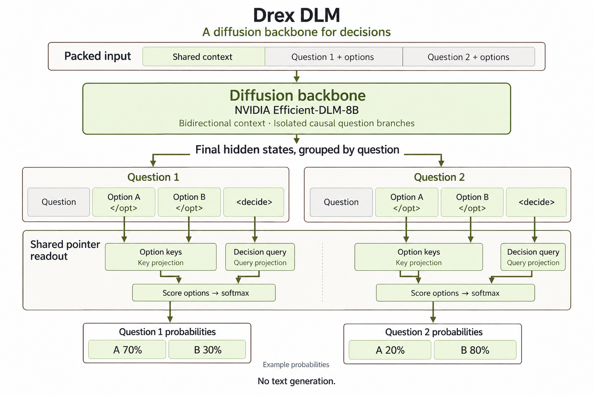

# Drex DLM

A decision model built on NVIDIA's [Efficient-DLM-8B](https://huggingface.co/nvidia/Efficient-DLM-8B) diffusion language model plus a small pointer head. All questions of a request are scored in a single forward pass.

[BF16 weights](https://huggingface.co/nace-ai/drex-dlm) · [Q8_0 GGUF](https://huggingface.co/nace-ai/drex-dlm-Q8_0) · [llama.cpp fork](https://github.com/nace-ai/llama.cpp) (branch `edlm`) · [Ollama fork](https://github.com/nace-ai/ollama) (branch `nace-edlm`)

Tested on Apple M5 Max (128 GiB), Apple M5 Pro (48 GiB) and NVIDIA H100 80 GB SXM (CUDA). Python 3.12 is the validated interpreter. The BF16 weights take about 16 GB; memory use grows with context length and batch size.

## How it works

The shared context (`state`) uses bidirectional attention. Each question branch attends to the context and uses causal attention within itself; state tokens cannot attend to questions, and branches cannot attend to each other. A shared pointer head projects the final-layer state at the decision marker into a query and the state at each option-ending marker into a key. Scaled dot products, temperature scaling and a softmax over each question's options give the probabilities.



<sub>The diagram uses `<decide>` and `</opt>` as readable aliases for the decision and option-ending markers.</sub>

Requests within the packed-token budget run in one forward pass; larger ones are split across question rows.

## Performance

Drex DLM scores 52.31 on the [Decision Index 0.2](https://huggingface.co/spaces/multimodalart/jev-decision-index) leaderboard, ahead of the next five entries as of October 2026:

| Model | Index | Knowledge & Reasoning | Language Understanding | Retrieval & Classification | Tools & Automation | Arts & Human Taste |
| --- | ---: | ---: | ---: | ---: | ---: | ---: |
| Drex DLM | 52.31 | 50.71 | 57.77 | 54.25 | 48.59 | 50.25 |
| Decider chat · Gemma-4-31B | 51.93 | 44.54 | 58.91 | 50.34 | 66.99 | 38.89 |
| Jev | 51.67 | 50.54 | 59.74 | 43.35 | 66.86 | 37.86 |
| AutoJev-27B | 50.94 | 40.93 | 61.90 | 42.00 | 69.98 | 39.88 |
| Jebadiah 27B | 50.32 | 38.82 | 58.97 | 45.48 | 69.30 | 39.02 |
| simple-jev · Qwen3.8-27B | 50.21 | 36.61 | 60.16 | 50.22 | 66.95 | 37.10 |

## Python

```bash
hf download nace-ai/drex-dlm --local-dir weights/drex-dlm
python serve.py --model weights/drex-dlm --port 8000
```

To accept requests longer than 16,384 tokens, set `KEV_CONTEXT` (up to 32,768); see [Context length](../../docs/context-length.md).

## llama.cpp

The `edlm` architecture, GGUF converter and `/v1/systemone` endpoint live on branch `edlm` of [nace-ai/llama.cpp](https://github.com/nace-ai/llama.cpp). You need CMake and a C/C++ toolchain (Xcode Metal toolchain on Apple Silicon). Run these from the repository root:

```bash
git clone --branch edlm --single-branch https://github.com/nace-ai/llama.cpp.git
cmake -S llama.cpp -B llama.cpp/build
cmake --build llama.cpp/build --target llama-server --parallel 8
```

On NVIDIA, add `-DGGML_CUDA=ON` when configuring. Convert the weights to GGUF in a separate environment, because the converter's dependencies differ from the runtime's:

```bash
python3.12 -m venv llama.cpp/.venv-convert
llama.cpp/.venv-convert/bin/python -m pip install \
  -r llama.cpp/requirements/requirements-convert_hf_to_gguf.txt
llama.cpp/.venv-convert/bin/python llama.cpp/convert_hf_to_gguf.py weights/drex-dlm \
  --outfile weights/drex-dlm/drex-dlm-f16.gguf --outtype f16
```

Start the server:

```bash
GGML_METAL_TENSOR_DISABLE=1 llama.cpp/build/bin/llama-server \
  -m weights/drex-dlm/drex-dlm-f16.gguf \
  --host 127.0.0.1 --port 8097 \
  --embedding --pooling none \
  -c 16384 -b 16384 -ub 16384 -np 1 --no-warmup
```

Keep `GGML_METAL_TENSOR_DISABLE=1` on Apple Silicon: the Metal tensor matmul path gave incorrect results on long inputs. The flag is not needed on CUDA. Then, from another terminal:

```bash
curl http://127.0.0.1:8097/v1/systemone \
  -H 'Content-Type: application/json' -d @examples/request.json
```

The [Q8_0 GGUF](https://huggingface.co/nace-ai/drex-dlm-Q8_0) is a smaller option (pointer-head matrices stay F16). Download it into `weights/drex-dlm` and use its path in the command above; its model card has the tested configuration.

The default is 16,384 tokens and the maximum is 32,768. For 32,768, set `SYSTEMONE_CONTEXT=32768` and add `-c 32768 -b 32768 -ub 32768` (see [Context length](../../docs/context-length.md)).

## Ollama

[nace-ai/ollama](https://github.com/nace-ai/ollama), branch `nace-edlm`, launches the `llama-server` built from the llama.cpp checkout above and forwards `POST /v1/systemone`. Finish the llama.cpp build and conversion above first, then build the runner and daemon from the repository root (Go 1.26; the toolchain downloads automatically):

```bash
git clone --branch nace-edlm --single-branch https://github.com/nace-ai/ollama.git
cd ollama
export OLLAMA_LLAMA_CPP_SOURCE="$PWD/../llama.cpp"
cmake -S llama/server --preset darwin
cmake --build build/llama-server-darwin --target llama-server --parallel 8
GOTOOLCHAIN=auto go build -trimpath -o ollama .
cd ..
```

The `darwin` preset is for Apple Silicon. Write a Modelfile next to the GGUF:

```bash
cat > weights/drex-dlm/Modelfile <<'EOF'
FROM ./drex-dlm-f16.gguf
CAPABILITY decision
PARAMETER num_ctx 16384
EOF
```

Start the daemon and leave it running:

```bash
OLLAMA_HOST=127.0.0.1:11434 \
OLLAMA_LLAMA_SERVER="$PWD/ollama/build/llama-server-darwin/bin/llama-server" \
  ollama/ollama serve
```

In another terminal:

```bash
OLLAMA_HOST=127.0.0.1:11434 ollama/ollama create drex-dlm -f weights/drex-dlm/Modelfile
jq '. + {model: "drex-dlm"}' examples/request.json | curl http://127.0.0.1:11434/v1/systemone \
  -H 'Content-Type: application/json' -d @-
```

Ollama needs `"model"` in the request, which the `jq` filter adds. `GET /api/version` checks readiness. The default is 16,384 tokens and the maximum is 32,768. For 32,768, set `PARAMETER num_ctx 32768` and start the daemon with `SYSTEMONE_CONTEXT=32768`.

## Validation

Results were checked across the Python, llama-server and Ollama runners on Apple M5 Max and M5 Pro, and across Python and llama-server on CUDA. The Q8_0 GGUF loads and serves requests through llama-server at a 16,384-token context.

## License

Model weights: CC BY-NC 4.0, see [LICENSE.md](LICENSE.md).
