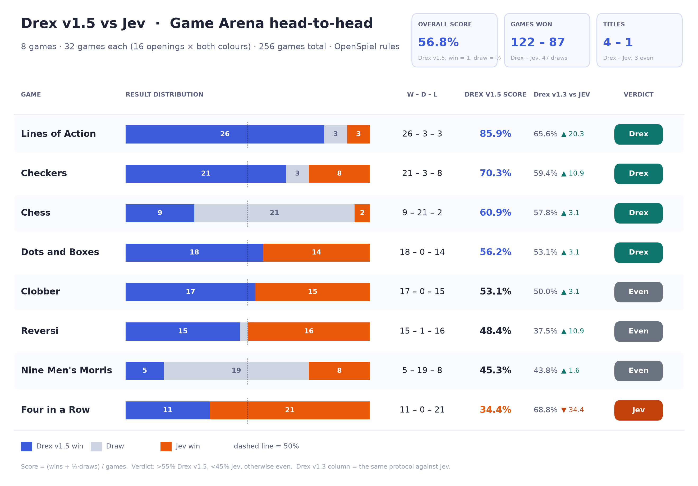

# Drex v1.5

A decision model built on [MiMo-V2.6-Distill-Qwen-9B](https://huggingface.co/XiaomiMiMo/MiMo-V2.6-Distill-Qwen-9B) with a [Kev](https://github.com/jaredpalmer/kev) pointer head. It takes a `state` and named typed questions ([request format](../../docs/request-format.md)) and returns a probability for every option; nothing is generated. It scores 58.08 on the public Decision Index 0.3.1, the **#1 model under 10B parameters** on the leaderboard.

[Weights](https://huggingface.co/nace-ai/drex-v1.5) · [llama.cpp fork](https://github.com/nace-ai/llama.cpp) (branch `drex-v1.5`) · [Ollama fork](https://github.com/nace-ai/ollama) (branch `drex-v1.5`)

It runs with Python, llama.cpp or Ollama. Requests of up to 16,384 tokens are accepted by default and up to 131,072 at most ([Context length](../../docs/context-length.md)). The bf16 weights take about 18 GB and the Q8_0 GGUF about 9.5 GB.

<details>
<summary>How it works</summary>

The backbone is a `Qwen3_5ForCausalLM` with 32 layers, about 9B parameters and hybrid attention (three linear-attention layers for every full-attention layer). Each question is scored in one forward pass over the state plus that question, and the pointer head in `head.pt` turns the result into probabilities. Nothing is generated, so the sampling values in `generation_config.json` do not apply.

</details>

## Performance

### Decision Index 0.3.1 (public only)

| Model | Public index | Raw | Knowledge & Reasoning | Language | Retrieval | Tools | Arts |
|---|---|---|---|---|---|---|---|
| **Drex v1.5** (9B) | **58.08** | 68.08 | 44.6 | 60.4 | 61.7 | 75.0 | 48.8 |
| Jev 1.13.0 | 57.96 | 68.55 | 53.9 | 59.2 | 55.4 | 75.1 | 39.1 |
| Bespoke Nimble 9B v3 | 57.19 | 68.38 | 41.0 | 60.7 | 55.5 | 84.2 | 44.0 |
| Cloudflare clef-flash | 56.15 | 66.53 | 53.0 | 47.2 | 52.2 | 81.9 | 48.4 |
| ezjev 4B s2 | 50.82 | 63.16 | 31.0 | 60.5 | 56.3 | 69.9 | 31.1 |

Public index only: the 37 public benchmarks in five areas, without the private tests. Area columns are chance-corrected skill × 100. The table shows Drex v1.5, Jev and the top three other models under 10B parameters on the [leaderboard](https://huggingface.co/spaces/multimodalart/jev-decision-index). The Drex v1.5 numbers are from our own run of the official kit on the full public suite (the text suite is the same in 0.3 and 0.3.1); the other rows are the leaderboard's. Drex v1.5 is the highest-scoring model under 10B parameters; Jev's parameter count is not published. Drex v1.5, Jev and Nimble are within the board's 0.9-point tie band. Drex v1.5 is ahead of Jev on 20 of the 37 benchmarks.

<details>
<summary>JevBench (231 public items)</summary>

| Model | Accuracy | Easy | Standard | Hard |
|---|---|---|---|---|
| Jev 1.13.0 | 87.0% | 100.0% | 98.6% | 73.9% |
| **Drex v1.5** | **86.2%** | 100.0% | 95.8% | **73.9%** |
| decider-4b v2.1 | 83.1% | 100.0% | 98.6% | 65.8% |

</details>

<details>
<summary>Long-context benchmarks</summary>

Long documents with typed questions; every request was answered.

| Context length | Accuracy | Truncated to 8k | Median latency |
|---|---|---|---|
| 8k – 32k tokens | 89.5% | 76.5% | 0.65 s |
| 32k – 128k tokens | 93.4% | 78% | 2.0 s |

</details>

<details>
<summary>Game arena against Jev</summary>

Eight OpenSpiel games, 32 games each (16 openings × both colours): **122 wins, 47 draws, 87 losses (56.8%)**.



</details>

## Python

Needs a CUDA GPU; memory use grows with document length. The server answers `POST /v1/systemone`.

```bash
hf download nace-ai/drex-v1.5 --local-dir weights/drex-v1.5
python serve.py --model weights/drex-v1.5 --port 8000
```

## llama.cpp

Runs on CUDA, Metal and CPU. Run these from the repository root:

```bash
git clone --branch drex-v1.5 --single-branch https://github.com/nace-ai/llama.cpp.git
cmake -S llama.cpp -B llama.cpp/build
cmake --build llama.cpp/build -j --target llama-server llama-quantize

python llama.cpp/convert_hf_to_gguf.py weights/drex-v1.5 --no-mtp --outtype bf16 \
  --outfile weights/drex-v1.5/drex-v1.5.gguf
llama.cpp/build/bin/llama-quantize weights/drex-v1.5/drex-v1.5.gguf \
  weights/drex-v1.5/drex-v1.5-Q8_0.gguf Q8_0     # optional, about 9.5 GB

llama.cpp/build/bin/llama-server -m weights/drex-v1.5/drex-v1.5.gguf \
  --embedding --pooling none -np 2 -c 32768 -b 16384 -ub 2048 --port 8000
```

The server answers `POST /v1/systemone` with the same request and response as the Python server. On NVIDIA, add `-DGGML_CUDA=ON` when configuring the build. On a GPU (CUDA or Metal), add `-ngl 99` to the server command; leave it off to run on the CPU.

`-np 2` encodes the state once and shares it across questions. `-c` is split across the two slots, so this command accepts requests up to 16,384 tokens. For up to 131,072 tokens, set `SYSTEMONE_CONTEXT=131072` and use `-c 262144` ([Context length](../../docs/context-length.md)).

<details>
<summary>Tested hardware</summary>

AWS g5.2xlarge (NVIDIA A10G 24 GB, 8 vCPU AMD EPYC 7R32, 32 GiB RAM, Ubuntu 24.04, CUDA 13.2), against the Python server on two requests (87 and 5,104 tokens, six questions): probabilities differ by at most 0.0075 in bf16 and 0.034 in Q8_0, and every answer is the same.

Apple M5 Pro (18-core CPU, 20-core GPU, 48 GB unified memory, macOS 26.5.2): the Q8_0 GGUF gives the same answers on Metal (probabilities within 0.019) and on the CPU (within 0.035).

</details>

## Ollama

Use the Nace fork of Ollama with a `llama-server` built from the `drex-v1.5` branch above. Convert the GGUF first, as in the llama.cpp steps.

<details>
<summary>Build the fork</summary>

From the repository root:

```bash
git clone --branch drex-v1.5 --single-branch https://github.com/nace-ai/ollama.git
cd ollama
export OLLAMA_LLAMA_CPP_SOURCE="$PWD/../llama.cpp"
cmake -S llama/server --preset darwin
cmake --build build/llama-server-darwin --target llama-server --parallel 8
GOTOOLCHAIN=auto go build -trimpath -o ollama .
cd ..
```

For CPU use the `cpu` preset and `build/llama-server-cpu`; for NVIDIA on Linux use `llama_cuda_v13_linux` (or `llama_cuda_v12_linux`) and `build/llama-server-cuda_v13` (or `-cuda_v12`) in place of `darwin` and `build/llama-server-darwin` here and below.

</details>

Write a `Modelfile` next to the GGUF:

```bash
cat > weights/drex-v1.5/Modelfile <<'EOF'
FROM ./drex-v1.5.gguf
CAPABILITY decision
PARAMETER num_ctx 16384
EOF
```

Start the daemon with the fork's binary and leave it running:

```bash
OLLAMA_HOST=127.0.0.1:11434 \
OLLAMA_LLAMA_SERVER="$PWD/ollama/build/llama-server-darwin/bin/llama-server" ollama/ollama serve
```

In another terminal, import and call the model:

```bash
OLLAMA_HOST=127.0.0.1:11434 ollama/ollama create drex-v1.5 -f weights/drex-v1.5/Modelfile
jq '. + {model: "drex-v1.5"}' examples/request.json | curl http://127.0.0.1:11434/v1/systemone \
  -H 'Content-Type: application/json' -d @-
```

Ollama needs `"model"` in the request, which the `jq` filter adds. It starts `llama-server` with two slots, so the state is encoded once per request. The default is 16,384 tokens. For up to 131,072, set `PARAMETER num_ctx 131072`, import again, and start the daemon with `SYSTEMONE_CONTEXT=131072`.

<details>
<summary>Tested hardware</summary>

Through Ollama on the g5.2xlarge above, with the same two requests: probabilities differ from the Python server by at most 0.0075 in bf16, and every answer is the same.

</details>

## License

Nace.AI Open RAIL-M license, see [LICENSE](LICENSE).
